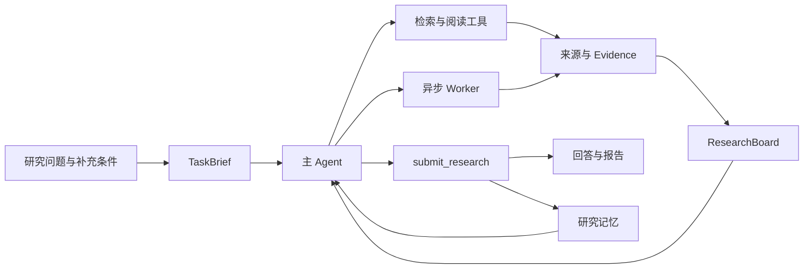

<div align="center">

# Paper Search Harness

**从研究问题出发，找到论文，读懂依据。**

面向 AI 与计算机研究的论文检索 Agent，配备可追溯、可接续的研究工作台。


[](LICENSE)

[快速开始](#快速开始) · [工作原理](#工作原理) · [配置指南](docs/configuration.md) · [架构说明](docs/architecture.md)

</div>

把“找几篇论文”变成一项有依据的研究：明确需求，检索候选，阅读摘要或全文，判断相关性与约束，再交付带来源的结果。研究中可以补充条件、查看工具记录、打开证据，也可以在中断后继续。

## 可以做什么

| 场景 | 示例 |
| --- | --- |
| **主题检索** | 找近两年关于 Agent 长期记忆的代表工作，优先有公开代码的论文。 |
| **相关工作比较** | 以这篇论文为起点，寻找解决同类问题、但采用不同机制的方法。 |
| **Baseline 选择** | 我的任务是多跳问答，使用开源模型。帮我选实验基线，并说明比较时要控制哪些条件。 |

- **先匹配，再看质量。** 区分必要条件与偏好，结合发表信息、机构、代码和实验依据判断；证据不足的候选保留为待确认项。
- **查得到，也读得下去。** 支持 arXiv、网页检索 MCP、论文页面解析和 PDF 阅读；引用可回到来源或 PDF 页码。
- **研究可以持续推进。** Quick 由单 Agent 执行；Deep 按需委派独立检索或证据任务，支持增量收取、追加指令和取消。
- **过程可见，结果一致。** 查看任务进度、token 用量、工具调用及模型输入输出；回答与报告使用同一份结构化研究结果。
- **经验可以复用。** 按需加载研究 Skills，保存有来源的研究记忆；偏好可查看、修改和删除。

## 快速开始

需要 **Python 3.11+**、**Node.js 22.13+**，以及支持流式响应和工具调用的模型 API。请在项目根目录执行以下命令。

### 1. 安装依赖

```bash
python -m venv .venv

# macOS / Linux
source .venv/bin/activate

# Windows PowerShell
# .venv\Scripts\Activate.ps1

python -m pip install -e ".[dev]"
npm --prefix frontend ci
```

已有 Conda 环境也可以直接使用，无需额外创建虚拟环境。

### 2. 配置模型

默认配置位于 [`backend/paper_search/config/default.yaml`](backend/paper_search/config/default.yaml)，以 DashScope 的 OpenAI 兼容接口为例。先确认模型名称和参数适用于你的账号，再在**启动后端的终端**中设置密钥：

```bash
# macOS / Linux
export PAPER_SEARCH_MODEL_API_KEY="your-model-api-key"
```

```powershell
# Windows PowerShell
$env:PAPER_SEARCH_MODEL_API_KEY = "your-model-api-key"
```

如需更换模型或服务商，复制默认配置为 `config.local.yaml`，再设置 `PAPER_SEARCH_CONFIG=config.local.yaml`。本地配置已被 Git 忽略；详细字段和 MCP 配置见[配置指南](docs/configuration.md)。`.env.example` 仅作变量说明，程序不会自动读取 `.env`。

默认启用 arXiv，PDF 与记忆使用关键词检索。向量检索和网页 MCP 可独立启用。

未配置密钥时也可以启动并浏览工作台；发起研究前需要填写有效的模型凭据。

### 3. 启动

后端终端：

```bash
python -m uvicorn paper_search.bootstrap:create_production_app --factory --host 127.0.0.1 --port 8000
```

前端终端：

```bash
npm --prefix frontend run dev
```

打开 **[http://localhost:5173](http://localhost:5173)**。接口文档位于 [http://127.0.0.1:8000/docs](http://127.0.0.1:8000/docs)。首次运行会在 `data/` 创建数据库和资料存储；首次加载 tokenizer 可能需要联网下载词表。

## 工作原理



模型决定下一步研究什么，Harness 负责执行边界：

| 机制 | 作用 |
| --- | --- |
| 版本化研究意图 | 用户纠正后，旧分工和判断不能覆盖当前需求。 |
| 来源、证据与判断分离 | 召回顺序不代表相关性；搜索片段不直接升级为论文摘要证据。 |
| 有限并发与统一期限 | 主 Agent 和 Worker 共享时间预算，临近截止时保留收尾时间。 |
| 持久化执行记录 | 保存任务、工具结果与事件，区分可重放读取和结果不确定的副作用。 |
| 分层上下文管理 | 优先压缩重复历史和工具正文，必要时生成摘要；原始资料仍可读取。 |
| 统一研究交付 | 推荐、比较和报告共用 `ResearchResult`，避免多份结果彼此偏离。 |

默认 Quick 的目标时间 / 截止时间为 **90 / 180 秒**，Deep 为 **600 / 900 秒**；token 软目标分别为 **64k / 256k**。这些是可调整的执行参数，不是性能承诺。更多实现细节见[架构说明](docs/architecture.md)。

## 目录

```text
backend/paper_search/
├── api/                  # HTTP 接口与 SSE 事件流
├── harness/              # Agent Loop、编排、预算、上下文与恢复
├── retrieval/            # 来源检索、论文身份与元数据解析
├── documents/            # PDF 下载、解析与索引
├── tools/                # 工具定义、调用日志与 MCP
├── storage/              # SQLite、全文/向量检索与资料文件
├── skills/               # 研究方法与按需参考资料
├── prompts/              # 主 Agent、Worker 与摘要指令
├── config/               # 默认配置与模型能力
└── research.py           # 研究判断、提交规则与结果渲染
frontend/                 # React 工作台与生成的 API 类型
docs/                     # 配置指南与架构说明
scripts/                  # OpenAPI 导出
```

## 开发

```bash
python -m ruff check backend scripts
npm --prefix frontend run build
```

修改 HTTP 契约后，使用当前 Python 环境更新前端类型：

```bash
npm --prefix frontend run generate:api
```

欢迎围绕具体研究场景改进检索、证据处理和运行体验。提交问题时，请附上复现步骤、模型配置和经过脱敏的错误信息。

## 当前边界

这是面向本地使用的研究工作台，仍在迭代。检索覆盖受来源与网络状态影响；结构化校验能够检查引用归属、条件和版本，论文结论是否被证据充分支持仍需要模型判断与人工复核。PDF 目前采用文本提取，不提供 OCR 或专门的表格、公式解析。

当前仓库不提供检索质量或延迟的基准成绩。运行资料、对话、模型 Trace 和私人配置保存在本地，不随源码分发。服务没有面向公网部署的账号与权限管理。

## 参考与致谢

项目的组织方式与 Agent 运行机制参考了 [DeepSeek Harness](https://github.com/deepseek-ai/deepseek-harness)、[Pi](https://github.com/earendil-works/pi) 和 [Agent Skills](https://agentskills.io/specification)。它们为模块边界、Agent Loop 和按需能力加载提供了很好的设计参考。

采用 [MIT](LICENSE) 许可证。依赖项目及外部论文、网页和代码分别遵循其自身许可证与使用条款。
